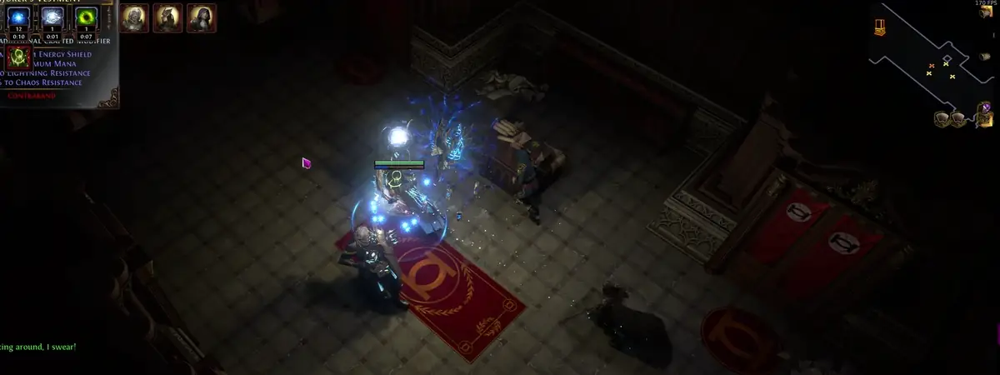
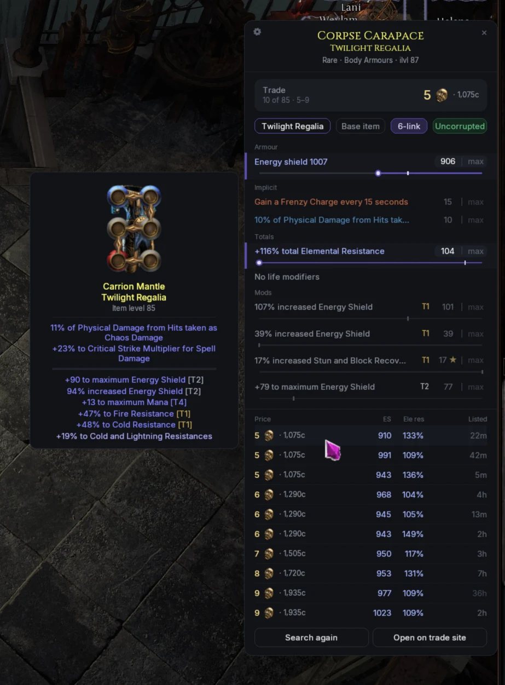
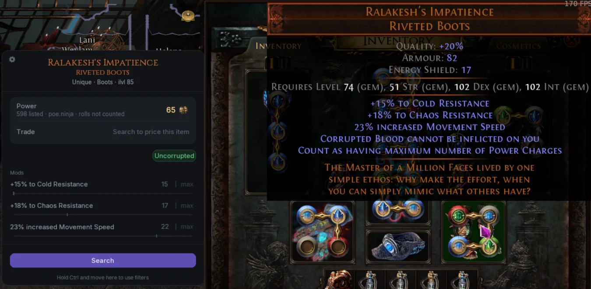
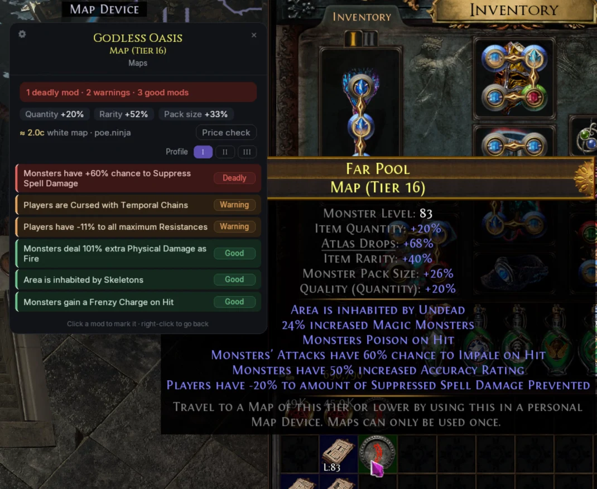

# Waytrade

In-game price checks for Path of Exile and Path of Exile 2 on Linux, for
when the game runs as a native Wayland client.

Hover an item, press **Ctrl+D** (**Ctrl+\`** in PoE2), and a panel opens
next to it with the item's price: poe.ninja for currency, uniques, gems, maps
and other priced items, and a ready-made trade search for rares. Maps and
PoE2's waystones get a check for dangerous mods.

<p align="center">
  
  <br>
  <em>Heist curio displays priced on sight, with tags that follow their tooltips.</em>
</p>

## Features

- **Price check on Ctrl+D:** poe.ninja prices for currency, uniques
  (unidentified ones recognised by their art), gems, maps, cluster jewels and
  high item level bases.
- **Trade search for rares:** filters built from the item's mods, with tier
  markers and sliders, searched only when you press Search and shown
  in the panel.
- **Map check:** deadly, warning and good mods marked at a glance, with
  profiles you can edit.
- **Vault reliquaries and Heist curio displays priced on screen:** the
  tooltips can't be copied, so Waytrade reads them and tags each one with its
  price.
- **Stash scroll:** Ctrl + mouse wheel switches stash tabs from anywhere.
- **Native Wayland, in fullscreen, on any compositor:** drawn into the game's
  own frames, no X11 or XWayland needed, and your clipboard is kept.

<table>
  <tr>
    <td width="50%"></td>
    <td width="50%">
      
      <br><br>
      
    </td>
  </tr>
  <tr>
    <td align="center"><em>Trade search for a rare</em></td>
    <td align="center"><em>A unique's price, and the map check</em></td>
  </tr>
</table>

## Why Waytrade, and how it's different

Price check overlays usually run as a separate, transparent window kept on
top of the game, with global hotkeys and clipboard access to see what you
copy. On Wayland, a client can't put itself above a fullscreen game, listen
to keys sent to another window, or read the clipboard in the background, at
least not in a way that works the same on every compositor. That's why those
overlays need the game on X11 or XWayland.

Waytrade works differently. It is a Vulkan layer, loaded into the game the way
MangoHud is:

- **The panel is drawn into the game's own frames.** There's no second
  window to keep on top, so it works in fullscreen, on any compositor, and
  leaves the game's direct scanout alone while no panel is open.
- **Hotkeys and the clipboard come from the game's own Wayland connection.**
  There's nothing to set up as a global shortcut, and no portal or
  compositor-specific permission is needed.
- **Your clipboard is kept.** Ctrl+D saves whatever the clipboard held (text,
  images, every format) and puts it back after the game copies the item.
- **It's light.** It's a small library in the game plus a small Rust daemon
  for prices. A headless Chromium starts only for trade searches (the trade
  site requires a real browser) and stops when unused.
- **It's safe.**
  - It only hooks the game's Vulkan presentation, the way MangoHud does.
    It doesn't read or change the game's memory or files. When you check
    an item, it looks at the pixels around the cursor in the frame the
    game shows, the way a screenshot would, to recognise unidentified
    uniques by their art.
  - The only keys it presses for you are the Ctrl+C that copies the item
    and, for stash scroll, Left/Right to switch stash tabs. These are the
    same keys you'd press yourself.
  - Every web request (poe.ninja, the trade site) comes from the separate
    daemon, never from the game client.
  - The daemon follows GGG's rate limits, so searches won't get your IP
    timed out.

The catch is that the game has to run on Proton's Wayland driver. If you play
on X11 or XWayland, other price check overlays already work there, and
Waytrade doesn't support X11 (and has no plans to).

## Quick start

You need:

- A Wayland session (KDE Plasma, GNOME, Sway, Hyprland, COSMIC, ...).
- Path of Exile on Steam with a Proton that has the Wayland driver
  (`PROTON_ENABLE_WAYLAND`).
- Write access to `/dev/uinput`, which Waytrade uses to send Ctrl+C to the
  game. Most desktops grant it to the logged-in user. Otherwise, add yourself
  to the `input` group.
- Optional: Chromium or Google Chrome for trade searches, and `xdg-utils` to
  open searches in your browser.

**1. Install.**

On Arch Linux and its derivatives, install
[`poe-waytrade`](https://aur.archlinux.org/packages/poe-waytrade) from the
AUR with your AUR helper:

```bash
paru -S poe-waytrade        # or: yay -S poe-waytrade
```

On other distros (with a recent glibc), download the `x86_64.tar.gz` from the
latest [release](https://github.com/Maselkov/poe-waytrade/releases) and
unpack it over `/`:

```bash
sudo tar -C / -xzf poe-waytrade-*-x86_64.tar.gz
```

Packages for other distros aren't available yet.

Or build the Arch package from a checkout:

```bash
cd packaging/arch && makepkg -si
```

**2. Set Path of Exile's (or Path of Exile 2's) Steam launch options**
(Properties → General):

```
waytrade %command%
```

This turns the overlay on, starts the game on Proton's Wayland driver, and
runs the price daemon for as long as the game does. It tells the games apart
by Steam's app id (see [Path of Exile 2](#path-of-exile-2)).

**3. Play.** A notice under the login screen says when the overlay is ready.
Hover an item and press **Ctrl+D**. Open the settings with **Ctrl+Alt+S**.

## Using it

### Path of Exile 2

PoE2 works the same way, with a few differences:

- **Hotkeys:** PoE2 can move with WASD, and the game sees every hotkey too,
  so Ctrl+D would walk your character away. PoE2's defaults are **Ctrl+\`**
  (the key under Esc) for a quick look, **Ctrl+Alt+\`** for a locked panel
  and **Ctrl+Alt+S** for the settings. There's no Alt+D or Ctrl+Alt+F.
- **Copying:** the overlay sends Ctrl+Alt+C, PoE2's advanced copy, with the
  mod tiers and ranges.
- **Prices:** in Exalted Orbs below a Divine Orb. poe.ninja's PoE2 prices
  cover currency, runes, essences, omens, uncut gems and the like, and
  uniques. Rares, waystones and the rest get a trade search on PoE2's trade
  site, with rune and desecrated mods, Spirit and rune sockets as filters.
- **Waystone check:** waystones open the map check, with its own marks for
  PoE2's waystone mods.
- **No item displays:** vault reliquaries and Heist curios are PoE1's.

PoE2 gets a daemon of its own (on the socket `@poe-waytrade-poe2`), with its
settings in `~/.config/poe-waytrade/poe2/` and its log in
`~/.local/state/poe-waytrade/daemon-poe2.log`. systemd's socket serves PoE1
only, so for PoE2 the launcher always starts the daemon.
`POE_WAYTRADE_GAME=poe1|poe2` overrides the game the launcher picks.

### Hotkeys

| Key | What it does |
|---|---|
| **Ctrl+D** | Quick look. Closes as soon as you move the mouse away. To use the panel, keep holding Ctrl and move onto it; it then stays until the mouse leaves it with Ctrl released. |
| **Ctrl+Alt+D** | A locked panel that stays open until you click its × or click anywhere in the game. |
| **Ctrl+C** | Your own copy of an item opens a quick look too, if turned on in the settings (off by default). |
| **Ctrl+Alt+S** | Settings. Also the gear at the top left of a panel. |
| **Ctrl+Alt+F** | Item displays: prices every display on screen (vault reliquaries, Heist curios) until you leave the area (see below). It starts by itself in vaults and Heist; this starts it anywhere else, or stops it. Can be turned off. |
| **Alt+D** | The old map check key; now the same as Ctrl+Alt+D. Can be turned off. |
| **Ctrl + mouse wheel** | Stash scroll: switches stash tabs with the cursor anywhere in the game. |

All of them except Ctrl+C can be rebound. The game keeps the keyboard (the
panel is part of its window), so it sees your hotkeys too. Pick combinations
PoE doesn't use. That's also why there's no Esc to close a panel. Hotkeys are
physical keys: on a non-US layout, a hotkey stays on the same key, and its
label names the US key there.

The panel opens next to PoE's inventory when you check an item there, or
next to the stash for items on the left half of the screen.

**Stash scroll** works like the game's own Ctrl + wheel over the stash, but
anywhere on the screen:
- Each notch down presses Right (the next tab), and each notch up presses Left.
- Over the stash itself the game already does this, so the overlay leaves
  those notches alone.
- The game still sees the wheel. Since you're holding Ctrl, it also sees
  Ctrl+Right and Ctrl+Left.
- On a touchpad, two-finger scrolling counts as a notch about every 30 pixels.

You can turn it off on the settings page's Hotkeys tab.

### What gets priced

From poe.ninja:

- Currency, fragments, essences, divination cards, omens, oils, fossils,
  tattoos and other Currency Exchange items. These prices come from the
  in-game Currency Exchange, where currency actually trades.
- Uniques, including 5L/6L and unidentified ones. An unidentified unique is
  recognised by its art when several uniques share its base, so you get its
  own price ("matched by art"). If no art matches clearly (on the ground,
  where items show no art, say), you get every unique on that base.
- Skill gems, by level, quality and corruption.
- Maps, invitations and beasts.
- Wickerman limbs (Viscera), matched by their implicits.
- White and magic cluster jewels, by enchant, passive count and item level
  bracket.
- Plain bases of item level 82+, by item level and influences.

With a trade search (see below):

- Rare and magic items.
- Identified uniques, alongside their poe.ninja price, since that price
  ignores rolls.
- Skill gems, alongside their poe.ninja price.

### Item displays (vaults)

The displays in Zealot's, Arkhon's, Scholar's and Machinist's Vaults show
items in tooltips that can't be copied with Ctrl+C. Waytrade reads them off
the screen instead and puts a price tag above each one, which follows the
tooltip as you move. The most valuable one in sight gets a gold border.

- It starts by itself when you enter one of those vaults, and stops when you
  leave. It knows from the game's log (`logs/Client.txt` in the game's
  folder). **Ctrl+Alt+F** stops it, or starts it anywhere else.
- Displays are found by the stone pillars on either side of their title
  plate ("Forbidden Reliquary"). The text is read with
  [ocrs](https://github.com/robertknight/ocrs), and names are matched
  against every item the trade site knows, so a misread letter doesn't
  matter.
- Uniques, currency, gems (by level, quality and corruption) and bases are
  priced from poe.ninja. Facetor's Lens is priced with a trade search for its
  stored experience. Rare Thief's Trinkets get a trade search with their mods.
- A tooltip partly covered by another one is read again from later frames
  until its name and enough of the rest show, and every display is read a
  couple more times after it's priced, in case the first look missed part
  of it. A tag hides while its tooltip is fully covered and comes back with
  it.
- The OCR models (about 12 MB, CC BY-SA 4.0) come with the package, in
  `/usr/share/poe-waytrade/ocrs/`. A build without them downloads them on
  first use to `~/.cache/poe-waytrade/ocrs/`. Set `POE_WAYTRADE_OCR_MODELS`
  to a folder that has `text-detection.onnx` and `text-recognition.onnx` to
  use your own.
- Price tags follow their tooltips exactly: each frame, before it's shown,
  the GPU finds every tooltip in it (a compute shader, about 0.15 ms of GPU
  time) and the tag is drawn there. Setting "Price tags follow by" to CPU
  (General tab) uses the older tracking instead: no GPU work, but tags trail
  a frame or two and overshoot on sudden turns. Without GPU support for it,
  CPU tracking is used anyway.
- The vault list, the automatic start and the log's path are under
  `auto_watch_areas`, `auto_watch` and `client_log` in
  `~/.config/poe-waytrade/settings.json`. Automatic start is also on the
  General tab.

`poe-waytrade-daemon scan <screenshot.png>` reads the displays in a
screenshot without the game, which is handy if a display isn't recognised.

### Item displays (Heist)

Heist's Curio Displays (the reward rooms of contracts and Grand Heist wings)
are priced the same way, but Heist maps are long and mostly combat, so there
it starts **idle**: it looks for a display once a second and tracks
nothing. As soon as one is in view it runs at full speed, and 5 seconds after
the last one leaves the screen it's idle again. Displays seen in the last 10
minutes get their price back at once.

- It knows it's in Heist from the game's own id for the area (Client.txt's
  "Generating level ... area" line), so the Laboratory and Mansion maps don't
  count. Turn it off with "Price them in Heist" (General tab).
- Curio displays are found by their "Curio Display" title plate.
- How rares are priced: a Thief's Trinket by its mods; an experimented base
  by its poe.ninja base price (by item level when the tooltip shows it); a
  rare with a Heist enchant by its type and the enchants that have a number
  ("8% increased Explicit Mana Modifier magnitudes", not "Has no Green
  Sockets"); any other rare by its mods.
- A rare is remembered by its name and base for the area: each read adds the
  mods it saw (other tooltips cover different lines each time), and the
  price is for everything seen so far, so it can only get more exact.
- Hold Alt over the displays (advanced mod descriptions) for the item level,
  which experimented bases are priced by.
- If a display isn't tagged, set `POE_WAYTRADE_SCAN_SAVE=<folder>` in the
  launch options: then Ctrl+Alt+F saves the next frame there (instead of
  turning the check off). A frame with the display on screen is what's needed
  to teach it a new kind of display.

### Map check

Maps, invitations, heist contracts and blueprints open the map check:

- A one-line verdict at the top, such as "1 deadly mod · 1 warning ·
  5 unmarked". Unmarked mods are counted so they don't get skimmed past.
- The map's rarity, pack size and "More ..." bonuses.
- Its poe.ninja price. For a rare map, that's the white map's price.
- Its mods. Click a mod to cycle it through deadly → warning → good →
  unmarked.

Marks are kept per profile (I/II/III). Reflect, no regen, less recovery,
−max res, cannot leech, player curses and a few others come pre-marked.

**Price check** switches to the map's trade search. It searches the map's base
("Map (Tier 16)") and blight, with its More currency/scarabs/maps/cards
bonuses ticked and its pack size and rarity unticked. **Map check** switches
back. Each view keeps its state, and switching locks the panel. Expedition
logbooks open on their price, with the map check one click away.

### Trade search

Items without a fixed price get filters for the official trade site:

- **Rare and magic items:** life, mana, attributes and resistances from any
  mod (crafted ones included) become totals. Only total life and the
  resistance totals start ticked. Other mods are listed unticked.
- **Identified uniques:** one filter per mod that rolls (fixed mods are left
  out), unticked. The search finds the unique by name.
- **Skill gems:** gem level (ticked at max level) and quality (ticked from
  16%, or 20% on a transfigured gem), with matching corruption. Level and
  quality are minimums, since a better gem listed for less is competition.
- **Weapons:** physical/elemental DPS, attack speed and critical strike
  chance.
- **Armour:** armour, evasion, energy shield, ward and block (unticked),
  scaled to 20% quality the way the trade site searches them.
- **Links:** 5- and 6-links get a links filter, ticked except on a rare
  5-link. An unlinked 6-socket gets a sockets filter.

You can also pick "Any Ring" or the exact base, and whether corrupted items
count. Uniques, gems and the Base item preset start on the item's own
corruption state. Other items start on Any, since their price is in their
mods.

An unidentified item gets an **Unidentified** chip. It starts off (any
listing); turned on, the search finds only unidentified ones, for uniques
bought as a gamble on their rolls, like Watcher's Eye. An unidentified
unique whose art was recognised is searched by name, like an identified one.

Each filter's minimum starts 10% of the mod's range below your roll (you can
change this in the settings). A roll at the top of its tier starts at exactly
that value, marked with a gold star. Waytrade copies items with PoE's advanced
description, so each mod's tier shows next to its value (T1 gold, T2 silver,
T3 bronze). Fractured mods count in the totals and also get a filter of their
own.

Ways to adjust a filter:

- **Click a row** to tick it.
- **Drag the slider** under it. The left handle sets the minimum and the
  right one the maximum (none at the far right).
- **Scroll the wheel** over its value. Each filter's value is split into a
  minimum half and a maximum half, and the wheel moves the half under the
  pointer one step. Stepping the maximum to the top of the range leaves no
  maximum.
- **Click a half to type into it.** The overlay takes the keyboard from the
  game while you type, so digits don't drink flasks. Tab switches halves.
  Enter applies and ticks the filter. Esc or a click in the game cancels. Typing needs a compositor with layer-shell (KDE Plasma, Sway,
  Hyprland and other wlroots ones, COSMIC). On GNOME and gamescope, use the
  wheel and sliders.

**Base item:** unfinished bases with crafting value (fractured, synthesised,
influenced, cluster or magic jewels, or item level 82+, without crafted mods,
corruption or 20% quality) get a **Base item** button. It searches the exact
base with a minimum item level, the fractured/synthesised/influence flags,
fractured mods, enchants, implicits and, on magic items, tier 1–2 mods. Any
non-unique 5- or 6-link gets it too, with the links ticked. White and magic
ones open on it, since they're worth their links and base.

Mods that are one of a list rather than a number are searched exactly and
ticked. Examples are a cluster jewel's added small passives, an anointment, or
Forbidden Flame/Flesh's notable. Searing Exarch and Eater of Worlds items get
a filter for their implicit's tier.

**Searching.** Nothing is searched until you press **Search**, since every
search counts against GGG's rate limit. By default it counts only
**instant buyout** listings, which can't be price-fixed. The settings can
add in-person sellers, or any listing. The results show:

- An estimate: the median of the 10 cheapest listings, with the price range.
- The listings, grouped by price, with how long ago they were listed.
  Hovering a listing shows the item.
- A button to open the same search in your browser.

If you change a filter afterwards, the results are marked out of date until
you search again.

### Settings

Ctrl+Alt+S, or the gear on a panel. Changes apply at once.

- **Hotkeys:** click a key, then press the new combination. A key without Ctrl
  or Alt gets a warning, since the game sees it too. Choosing a combination
  another action uses swaps the two. Stash scroll is switched on and off
  here too.
- **General:**
  - The panel size, and the cursor over the panels: the game's or the
    desktop's.
  - The start-up notice, which says the overlay is running and stays while
    prices load.
  - Item displays: pricing them in vaults and in Heist, and how their price
    tags follow (GPU or CPU).
- **Price check:**
  - The league. "Current" (or "Current hardcore") follows poe.ninja into
    each new league.
  - Which listings a search starts with.
  - How far below your roll a ticked filter starts.
- **Map check:** the active profile, and resetting its marks.
- **About:** versions, where the logs are, and whether typing into panels works.

Settings are stored in `~/.config/poe-waytrade/settings.json`, and map marks in
`~/.config/poe-waytrade/map-mods.json`.

Environment variables, which take precedence over the settings page:

| Variable | Effect |
|---|---|
| `POE_LEAGUE` | League to price in |
| `POE_WAYTRADE_UI_SCALE` | Scales the whole UI |
| `POE_WAYTRADE_SCALE` | Overrides the pixel-per-logical-unit ratio, if clicks land in the wrong place under fractional scaling |
| `POE_WAYTRADE_HDR_NITS` | With HDR on, how bright the overlay's white is in nits (default: the desktop's SDR white, or 203) |
| `POE_WAYTRADE_HDR` | `hdr10`, `scrgb` or `off`: overrides HDR detection, if the overlay's colours are wrong with HDR on or off |

## Troubleshooting

- **No notice when the game starts, or the hotkeys do nothing.** Check that
  the launch options include `waytrade %command%`. Also check that the game
  isn't on XWayland (`PROTON_ENABLE_WAYLAND=0`): on XWayland the panel can
  draw, but it gets no keys or clipboard.
- **The notice says the price daemon isn't answering.** Read its log,
  `~/.local/state/poe-waytrade/daemon.log`.
- **The panel says "open /dev/uinput: Permission denied".** Ctrl+D can't
  send the game its Ctrl+C. See the `/dev/uinput` requirement under Quick
  start. Until it's fixed, turn on Ctrl+C in the settings and press it on an
  item yourself.
- **Trade searches fail.** Install Chromium or Google Chrome.
- **More detail.** Put `POE_WAYTRADE_LOG=/tmp/poe-waytrade.log` before
  `waytrade` in the launch options for the overlay's log. Add
  `POE_WAYTRADE_DEBUG=1` for a debug window showing focus, the last key and
  the clipboard state.
- **Item display tags jump or go missing.** Add `POE_WAYTRADE_TRACK_LOG=1`
  too: the log then has every tracking step and the GPU's timings. A short
  recording of the moment and that log are what's needed to look into it.

## Known limitations

- Native Wayland only. There's no X11 or XWayland input, and none is planned:
  other price check overlays already cover X11.
- Only one Vulkan device gets the overlay.
- HDR (PoE2): the overlay's white is as bright as the desktop's SDR white
  (KDE's SDR brightness, for one), if the compositor supports
  color-management-v1; otherwise 203 nits. Set `POE_WAYTRADE_HDR_NITS`
  (50 to 2000) to change it. Translucent edges blend in PQ space, so they're
  slightly off.
- No socket colour filters in trade searches.
- Item displays: tested on the vault reliquaries and Heist curio displays,
  at 1440p. Only English game clients are supported. Rares are priced by
  what's listed: an unusual enchant or a long list of mods often has no
  listings, and its tag shows "?".
- With fractional scaling, the game's cursor grows over the panels. Wine
  sizes its cursor for scale 1 on surfaces that aren't its own windows.
  Setting the cursor to "Desktop" (General tab) avoids it, at the cost of
  your desktop cursor over the panels.
- The item text still shows up in clipboard managers' history. They see the
  game's copy, and Klipper can't be told to forget a single entry.

## Development

How it works, building, testing the UI without the game, and releases are in
[docs/DEVELOPMENT.md](docs/DEVELOPMENT.md).

## License

poe-waytrade is free software under the GNU General Public License, version
3 or (at your option) any later version; see [LICENSE](LICENSE).

Bundled third-party code keeps its own license:
- `third_party/rmlui` is RmlUi 6.3 core (MIT).
- `third_party/stb` has stb_image (public domain).
- `protocols/wlr-layer-shell-unstable-v1.xml` is wlroots' layer-shell
  protocol, under its own permissive licence (in the file).
- `assets/fonts` has Inter and Cinzel, both under the SIL Open Font License
  (licence files alongside).
- The daemon uses [ocrs](https://github.com/robertknight/ocrs) (MIT or
  Apache-2.0). Its pre-trained models, which the package ships, are under CC
  BY-SA 4.0: Ocrs models (https://github.com/robertknight/ocrs-models),
  trained on the HierText dataset by Google Research
  ([packaging/ocrs-models-NOTICE.md](packaging/ocrs-models-NOTICE.md)).
